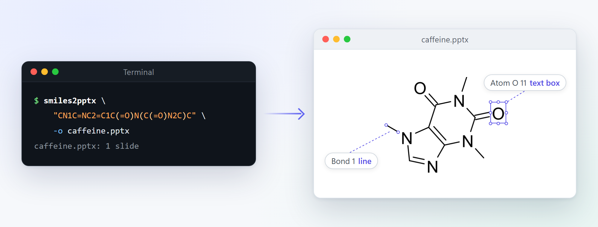
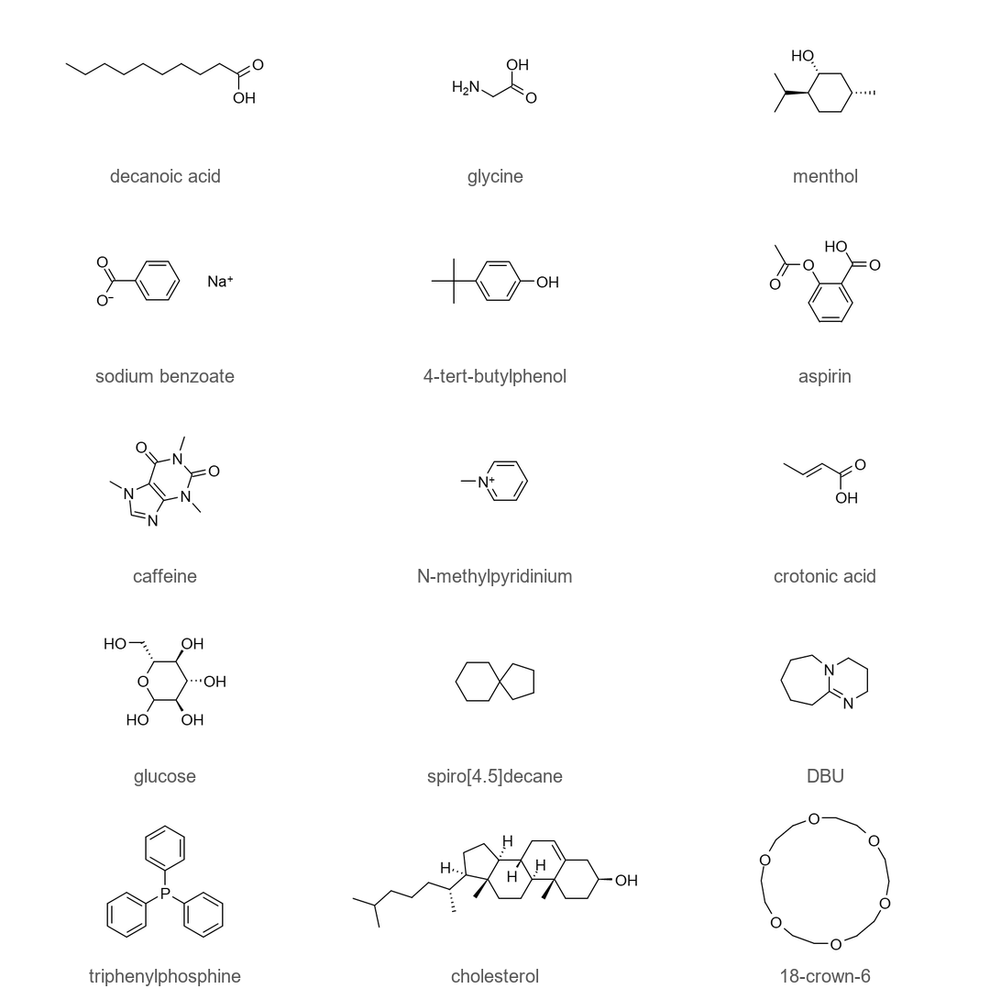
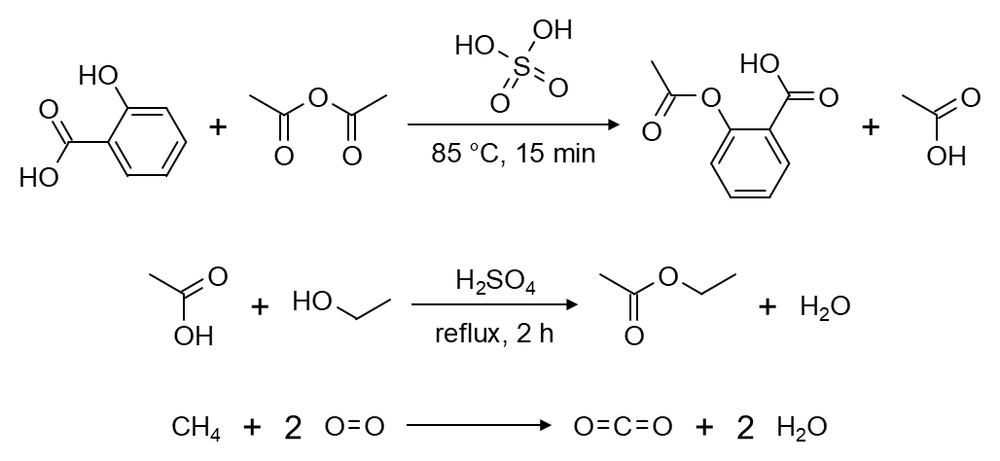
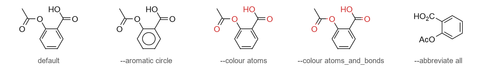

# smiles2pptx

SMILES から、PowerPoint 上で編集できる構造式を作るツールです。

[English](README.md)

<picture>
  <source media="(prefers-color-scheme: dark)" srcset="docs/header-dark.png">
  
</picture>

構造式を画像として貼り付けるのではなく、結合は線、原子ラベルはテキストボックスとして、PowerPoint の図形で描きます。スライドに置いたあとでも、ほかの図形と同じように、結合の色を変えたり、原子を動かしたり、ラベルを書き換えたりできます。

依存パッケージはありません。SMILES の解析、環の認識、2 次元座標の計算、pptx の書き出しまで、すべて Python の標準ライブラリだけで実装しています。外部の Web サービスにも接続しません。

## 特徴

- ブラケット原子（電荷・同位体）、分岐、環、芳香族原子、`.` で区切った複数の成分など、標準的な SMILES を読み込めます
- 立体中心（`@`、`@@`）は実線と破線のくさびで描き、`/` `\` は二重結合の E/Z として配置に反映します
- 反応 SMILES も描けます。試薬は矢印の上に構造式で描き、矢印の上下の文字や、同じ分子をまとめる係数にも対応しています
- 分子ごとにグループ化し（反応式は全体もグループ化します）、図形に `Bond 3`、`Atom O 2` のような名前を付けるので、「選択」ウィンドウで目的の図形を探せます
- 芳香環を円で描く、元素ごとに色を付ける、置換基を Ph や CO₂H のように略記する、といった表示を選べます
- Python 3.10 以上で動作します

## インストール

このリポジトリを clone して、pip でインストールしてください。

```
pip install .
```

## 使い方

### コマンドライン

```
smiles2pptx "CC(=O)Oc1ccccc1C(=O)O" -o aspirin.pptx
```

SMILES 1 つにつき 1 枚、16:9 のスライドの中央に構造式を描きます。SMILES は複数並べて指定できます。1 行に 1 つずつ書いたテキストファイルも読み込めます。

```
smiles2pptx --file examples/molecules.txt -o molecules.pptx
```

ファイルでは、SMILES のあとに空白を入れて名前を書くと、その名前が PowerPoint でのグループ名になります。空行と `#` で始まる行は無視されます。



反応式は `--reaction` で指定します。

```
smiles2pptx --reaction "CC(=O)O.OCC>>CC(=O)OCC.O" --above "H2SO4" --below "reflux, 2 h" -o ester.pptx
```

| オプション | 説明 |
|---|---|
| `-f`, `--file FILE` | SMILES を 1 行に 1 つ書いたファイルを読み込む（複数指定可） |
| `-r`, `--reaction SMILES` | 反応 SMILES（`反応物>試薬>生成物`）を描く |
| `--above TEXT`、`--below TEXT` | 反応の矢印の上・下に入れる文字 |
| `-o`, `--output FILE` | 出力ファイル（既定値: `smiles2pptx.pptx`） |
| `--scale X` | 描画のスケール（既定値: 1.4） |
| `--aromatic {kekule,circle}` | 芳香環をケクレ構造で描くか、円で描くか（既定値: `kekule`） |
| `--colour {black,atoms,atoms_and_bonds}` | 原子ラベル、またはラベルと結合に、元素ごとの色を付ける（既定値: `black`）。`--color` でも指定できます |
| `--abbreviate NAMES` | 指定した置換基を文字で描く（例: `Ph,CO2H`）。`all` ですべて |

`>` を含む SMILES は、`--reaction` を付けなくても反応式として扱います。`python -m smiles2pptx` でも、`smiles2pptx` コマンドと同じように実行できます。

### Python

```python
from smiles2pptx import Deck, Style

deck = Deck(style=Style(scale=1.4))
deck.add_molecule("CC(=O)Oc1ccccc1C(=O)O", name="aspirin")
deck.add_reaction("CC(=O)O.OCC>>CC(=O)OCC.O", above="H2SO4", below="reflux, 2 h")
deck.save("out.pptx")
```

SMILES を解析できない場合は `SmilesError` が発生し、問題のある文字の位置がメッセージに表示されます。

## 反応式



反応 SMILES は `反応物>試薬>生成物` の形で書きます。

- 反応物と生成物は横 1 列に並べ、間に `+` を入れます。
- 同じ分子が複数あるときは、係数を付けて 1 つにまとめます。たとえば `C.O=O.O=O>>O=C=O.O.O` は CH₄ + 2 O=O → O=C=O + 2 H₂O になります。
- 試薬は、矢印の上に構造式で描きます。`--above` と `--below` の文字は矢印のすぐ上と下に入り、矢印はそれらが収まる長さに伸びます。
- 矢印の上下の文字では、アルファベットの直後の数字が下付きになります。`H2SO4` は H₂SO₄ と表示されます。

## 描画の仕様

- 寸法は ACS Document 1996 の設定に合わせています。既定のスケールは 1.4 で、結合の長さは 20.2 pt、ラベルは Arial の 14 pt になります。`--scale` または `Style(scale=...)` で変更できます。PowerPoint ではグループを拡大しても文字サイズと線の太さは変わらないため、あとから引き伸ばすより、使いたいスケールで描くことをおすすめします。
- 芳香環は、既定ではケクレ構造で描きます。
- 炭素原子のラベルは省略します。ただし、電荷や同位体の指定がある炭素、二重結合を 2 つ持つ炭素（O=C=O の C）、原子 1 個だけの分子（CH₄）では表示します。
- 水素はラベルに含めて書きます（OH、NH₂）。結合が右側から来る場合は、水素を左側に書きます（HO）。結合が 2 本以上ある原子では、結合からいちばん離れた位置に水素を書きます。位置は右、左（環の左側にある HN）、元素記号の上か下のいずれかです（環の下の頂点にある NH は、N の下に H を書きます）。
- スライド（上下左右に 24 pt の余白をとった範囲）に収まらない構造式は、スケールを下げて描き、警告を表示します（Python では `FitWarning`）。

### 表示のオプション



| コマンドライン | Python | 結果 |
|---|---|---|
| `--aromatic circle` | `Style(aromatic="circle")` | 芳香環を、交互の二重結合ではなく円で描きます |
| `--colour atoms` | `Style(colour="atoms")` | 原子ラベルに元素ごとの色を付けます |
| `--colour atoms_and_bonds` | `Style(colour="atoms_and_bonds")` | ラベルに加えて、結合にも中点まで原子の色を付けます |
| `--abbreviate Ph,CO2H` | `Style(abbreviate=("Ph", "CO2H"))` | 指定した置換基を文字で描きます。`all` を指定すると、登録されている略記をすべて使います |

これらのオプションは組み合わせて使えます。

- 芳香環は、7 員環までの環を対象に 4n+2 則で判定します。ケクレ構造で書いた環（`C1=CC=CC=C1`）も円で描かれます。
- 標準で使える略記は Ph、tBu、CO2H、OAc です。構造が完全に一致する置換基だけを略記するので、エステルやカルボキシラートアニオンが CO2H になることはありません。
- 略記を追加するには、独自の表を渡します。各項目には、置換基の SMILES（結合先の原子を `*` として先頭に書きます）、結合が左から来るときの文字、右から来るときの文字を指定します。

  ```python
  from smiles2pptx import Deck, Style
  from smiles2pptx.style import ABBREVIATIONS

  style = Style(abbreviate="all", abbreviations={**ABBREVIATIONS, "OMe": ("*OC", "OMe", "MeO")})
  ```

- 元素の色も、`Style(element_colours={...})` で同じように変更できます。

## 制限事項

- 架橋環やかご型の分子（カンファー、アダマンタン、キュバン）も描けますが、結合が交差することがあります。
- 反応式は 1 段階のみで、矢印は 1 種類です。
- フォントは Arial のみです。ラベルの幅を Arial の文字幅から計算しているためです。

## 開発

```
pip install -e ".[dev]"
pytest
```

`tests/data` の参照データはリポジトリに含まれているので、テストの実行に必要なのは pytest だけです。参照データを作り直す場合は `tools/` のスクリプトを使います（RDKit が必要です）。この README の画像は `tools/make_readme_images.py` で作成しています。実行には Pillow、Google Chrome、PowerPoint がインストールされた Windows が必要です。

## 謝辞

2 次元の配置のアルゴリズムは、SmilesDrawer の論文（Probst and Reymond, *J. Chem. Inf. Model.* 2018, [doi:10.1021/acs.jcim.7b00425](https://doi.org/10.1021/acs.jcim.7b00425)）で発表された方法に基づいています。smiles2pptx では、これを Python で一から実装しています。

## ライセンス

[MIT](LICENSE)
