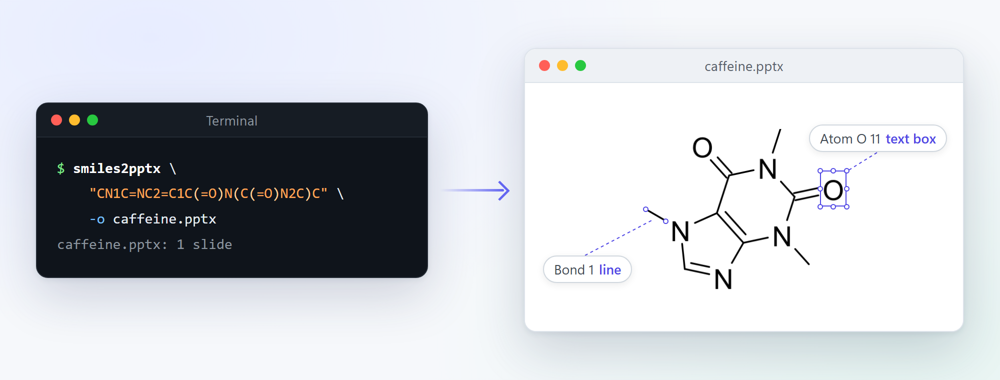
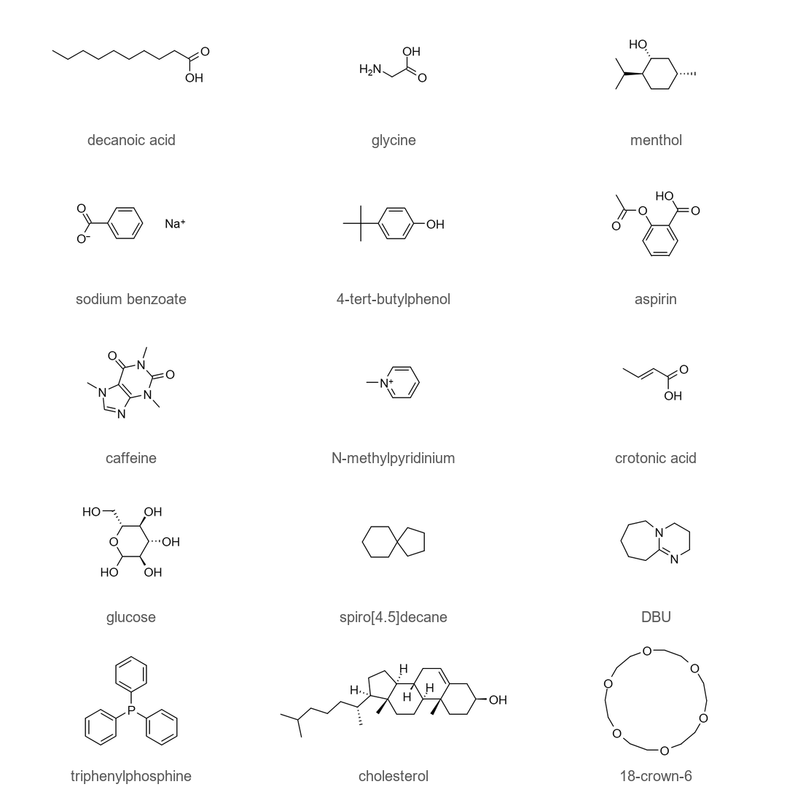
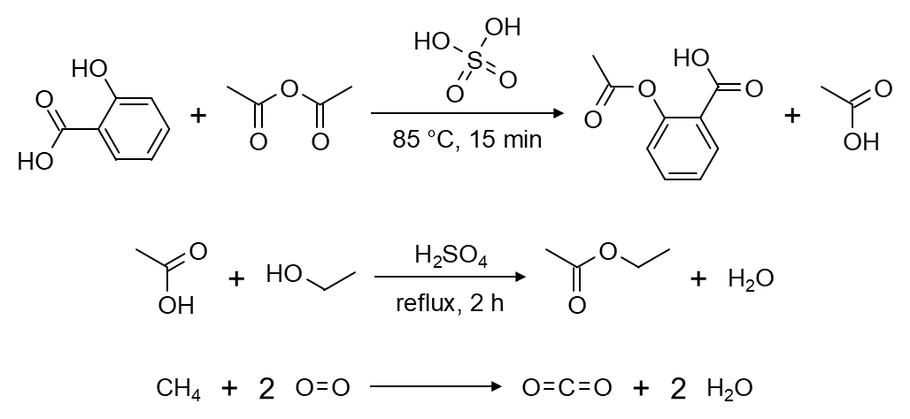
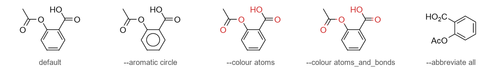

# smiles2pptx

Turn SMILES into chemical structures you can still edit in PowerPoint.

[日本語](README.ja.md)

<picture>
  <source media="(prefers-color-scheme: dark)" srcset="docs/header-dark.png">
  
</picture>

smiles2pptx draws structures with native PowerPoint shapes instead of inserting a picture:
every bond is a line and every atom label is a text box. Once the structure is on the
slide you can recolour a bond, move an atom or fix a label like any other shape.

There are no dependencies. SMILES parsing, ring perception, 2D layout and the pptx writer
are all implemented on top of the Python standard library, and nothing is sent to a web
service.

## Features

- Reads standard SMILES: bracket atoms (charges, isotopes), branches, rings, aromatic
  atoms and disconnected parts separated by `.`
- Draws stereocentres (`@`, `@@`) with solid and hashed wedges, and lays out `/` `\`
  double bonds as E/Z
- Draws reaction SMILES, with reagents over the arrow, text above and below it, and
  coefficients for repeated molecules
- Groups each molecule (and the whole scheme, for a reaction) and names the shapes
  (`Bond 3`, `Atom O 2`), so they are easy to find in the Selection Pane
- Optional styles: circles in aromatic rings, element colours, and substituent
  abbreviations such as Ph and CO₂H
- Works with Python 3.10 or later

## Installation

Clone this repository and install it with pip:

```
pip install .
```

## Usage

### Command line

```
smiles2pptx "CC(=O)Oc1ccccc1C(=O)O" -o aspirin.pptx
```

Each SMILES is drawn in the centre of its own 16:9 slide. You can pass several SMILES at
once, or a text file with one SMILES per line:

```
smiles2pptx --file examples/molecules.txt -o molecules.pptx
```

In the file, anything after the first space is used as the name of the group in
PowerPoint. Blank lines and lines starting with `#` are ignored.



Use `--reaction` for a reaction:

```
smiles2pptx --reaction "CC(=O)O.OCC>>CC(=O)OCC.O" --above "H2SO4" --below "reflux, 2 h" -o ester.pptx
```

| Option | Description |
|---|---|
| `-f`, `--file FILE` | Read SMILES from a file, one per line (can be repeated) |
| `-r`, `--reaction SMILES` | Draw a reaction SMILES (`reactants>agents>products`) |
| `--above TEXT`, `--below TEXT` | Text above and below the reaction arrow |
| `-o`, `--output FILE` | Output file (default: `smiles2pptx.pptx`) |
| `--scale X` | Drawing scale (default: 1.4) |
| `--aromatic {kekule,circle}` | Draw aromatic rings with alternating double bonds or with a circle (default: `kekule`) |
| `--colour {black,atoms,atoms_and_bonds}` | Colour atom labels, or labels and bonds, by element (default: `black`); `--color` also works |
| `--abbreviate NAMES` | Draw the named groups as text, e.g. `Ph,CO2H`, or `all` |

A SMILES that contains `>` is treated as a reaction even without `--reaction`.
`python -m smiles2pptx` does the same as the `smiles2pptx` command.

### Python

```python
from smiles2pptx import Deck, Style

deck = Deck(style=Style(scale=1.4))
deck.add_molecule("CC(=O)Oc1ccccc1C(=O)O", name="aspirin")
deck.add_reaction("CC(=O)O.OCC>>CC(=O)OCC.O", above="H2SO4", below="reflux, 2 h")
deck.save("out.pptx")
```

If a SMILES can't be parsed, `SmilesError` is raised and its message shows the position
of the character that caused it.

## Reactions



Reaction SMILES have the form `reactants>agents>products`.

- Reactants and products are placed on one line, with `+` between them.
- Repeated molecules are merged and given a coefficient, so `C.O=O.O=O>>O=C=O.O.O`
  becomes CH₄ + 2 O=O → O=C=O + 2 H₂O.
- Agents are drawn as structures above the arrow. The `--above` and `--below` texts go
  directly over and under the arrow, and the arrow is lengthened to fit them.
- In those texts, a digit that follows a letter becomes a subscript, so `H2SO4` is shown
  as H₂SO₄.

## Drawing style

- Sizes follow the ACS Document 1996 settings. The default scale is 1.4, which gives
  20.2 pt bonds and 14 pt labels in Arial. Change it with `--scale` or `Style(scale=...)`.
  PowerPoint doesn't change font sizes or line widths when a group is resized, so it's
  better to draw at the scale you want than to stretch the drawing afterwards.
- Aromatic rings are drawn as Kekulé structures by default.
- Carbon atoms are not labelled, except when they carry a charge or an isotope, have two
  double bonds (the C in O=C=O), or are the only atom in the molecule (CH₄).
- Hydrogens are written as part of the label (OH, NH₂) and move to the left when the bond
  comes in from the right (HO). On an atom with two or more bonds, they go where they are
  farthest from the bonds: on the right, on the left (HN on the left side of a ring), or
  above or below the symbol (an NH at the bottom of a ring is drawn as N with H below it).
- A drawing that doesn't fit on the slide (with a 24 pt margin on each side) is drawn at a
  smaller scale, and a warning is shown (a `FitWarning` in Python).

### Style options



| Command line | Python | Result |
|---|---|---|
| `--aromatic circle` | `Style(aromatic="circle")` | A circle in each aromatic ring instead of alternating double bonds |
| `--colour atoms` | `Style(colour="atoms")` | Atom labels in element colours |
| `--colour atoms_and_bonds` | `Style(colour="atoms_and_bonds")` | Labels in element colours, and each bond coloured up to its midpoint |
| `--abbreviate Ph,CO2H` | `Style(abbreviate=("Ph", "CO2H"))` | The named groups as text; `all` selects every abbreviation |

The options can be combined.

- Aromatic rings are detected with the 4n+2 rule in rings of up to seven atoms, so a ring
  written as a Kekulé structure (`C1=CC=CC=C1`) gets a circle as well.
- The built-in abbreviations are Ph, tBu, CO2H and OAc. A group is abbreviated only when
  it matches exactly, so CO2H is not used for an ester or a carboxylate anion.
- To add an abbreviation, pass your own table. Each entry is the group as a SMILES
  starting with `*` (the atom it is attached to), the text to use when the bond comes from
  the left, and the text to use when it comes from the right:

  ```python
  from smiles2pptx import Deck, Style
  from smiles2pptx.style import ABBREVIATIONS

  style = Style(abbreviate="all", abbreviations={**ABBREVIATIONS, "OMe": ("*OC", "OMe", "MeO")})
  ```

- Element colours can be changed in the same way, with `Style(element_colours={...})`.

## Limitations

- Bridged and cage ring systems (camphor, adamantane, cubane) can be drawn, but some bonds
  may cross.
- Only single-step reactions with one type of arrow are supported.
- Arial is the only font, because label widths are calculated from its metrics.

## Development

```
pip install -e ".[dev]"
pytest
```

The reference data in `tests/data` is checked in, so pytest is all you need to run the
tests. To regenerate it, use the scripts in `tools/`, which require RDKit. The images in
this README are made with `tools/make_readme_images.py`, which needs Pillow, Google Chrome
and Windows with PowerPoint installed.

## Acknowledgements

The 2D layout algorithm is based on the one published for SmilesDrawer (Probst and
Reymond, *J. Chem. Inf. Model.* 2018,
[doi:10.1021/acs.jcim.7b00425](https://doi.org/10.1021/acs.jcim.7b00425)). smiles2pptx
implements it from scratch in Python.

## License

[MIT](LICENSE)
